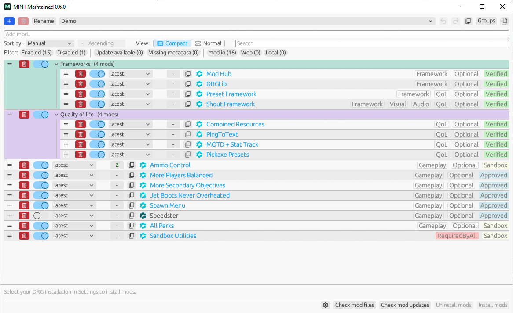
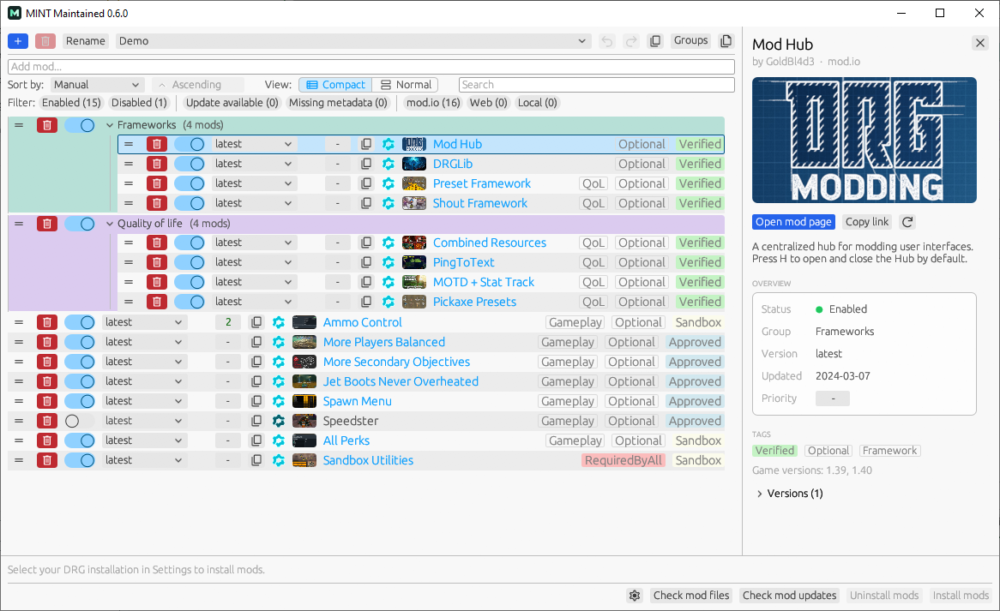
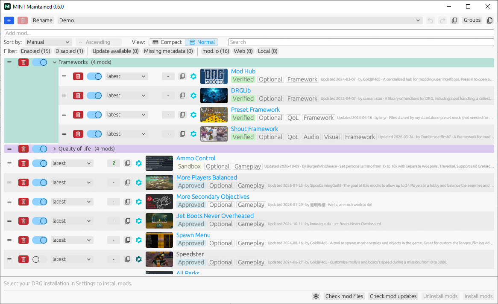

# MINT Maintained

## Built on great work

[Trumank](https://github.com/trumank) is the original creator of [MINT](https://github.com/trumank/mint). His excellent work made this project possible, and the credit for its foundation belongs to him. Please visit his profile and check out his other projects. There is much more to discover beyond MINT.

[Wasserkleber](https://github.com/Wasserkleber) continued that work with [mintfixed](https://github.com/Wasserkleber/mintfixed), bringing valuable fixes and improvements that this project also builds upon.

Thank you to both developers and everyone who contributed along the way.

## Continuing MINT

MINT Maintained is my continuation of their Deep Rock Galactic mod manager, focused on a refreshed interface, everyday quality of life improvements, and resolving bugs and crashes.

Organize profiles and shared groups, manage mod versions and load order, check updates, and install mods through one desktop application.

Select a mod to see its thumbnail, summary, author, status, version, tags and changelogs, and narrow long lists with search and filters.

Switch to the Normal view for larger rows with thumbnails, authors, update dates and summaries.

## Getting started

Download a build from [Releases](https://github.com/gabrielfordevelopment/mint-maintained/releases), extract it, and run MINT.

Select your game installation in Settings if necessary, configure a mod.io token when prompted, and add your mods. Keep DRG closed when installing or uninstalling mods.

## Switching from another fork

Saved data compatibility targets Trumank's original MINT and Wasserkleber's mintfixed formats. Other forks may use different settings or profile formats, so migration from them is not guaranteed.

Back up your settings and profiles before switching.

[Report an issue](https://github.com/gabrielfordevelopment/mint-maintained/issues) · [Changelog](CHANGELOG.md)

Original licenses and attribution are preserved.
